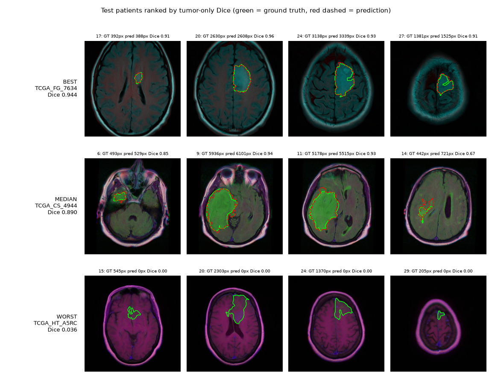
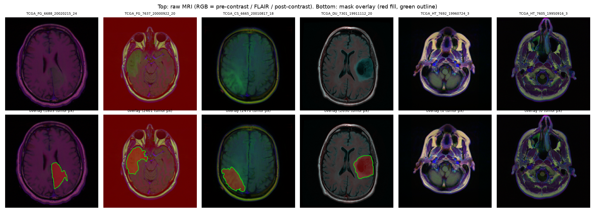
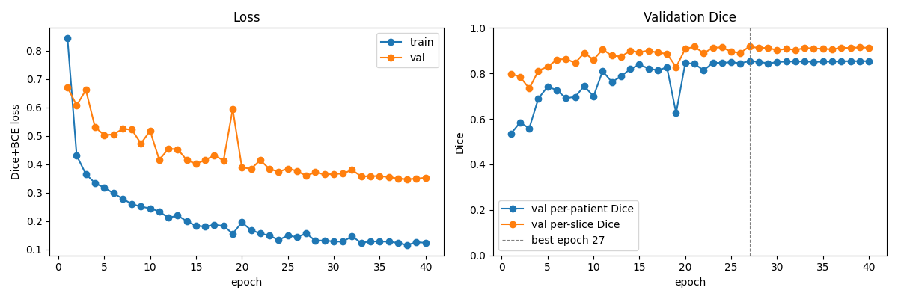
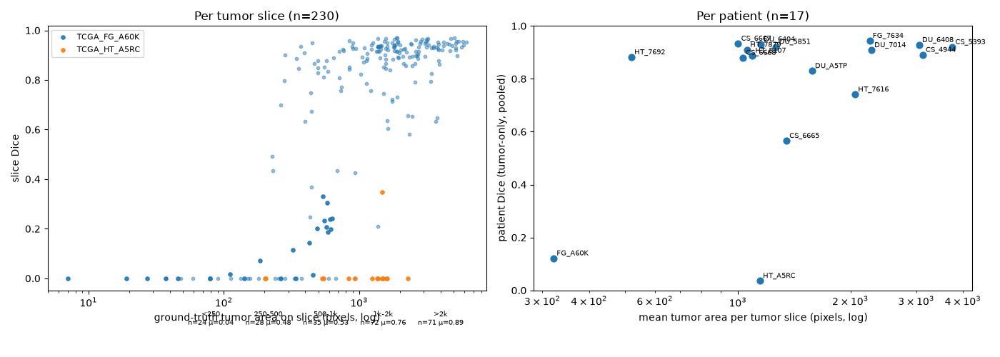
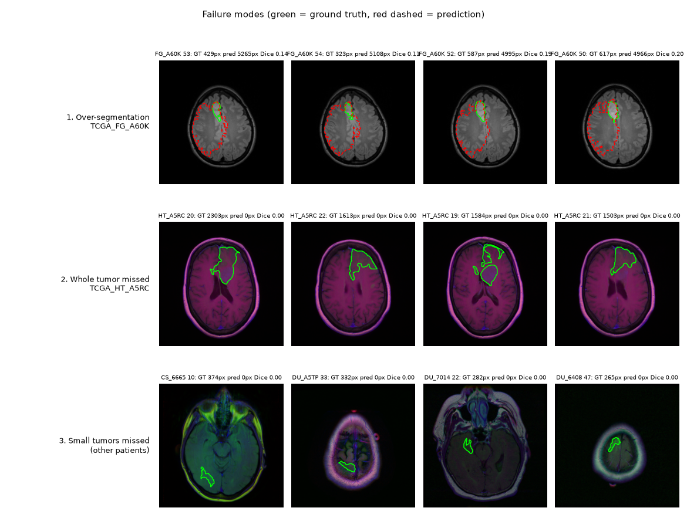
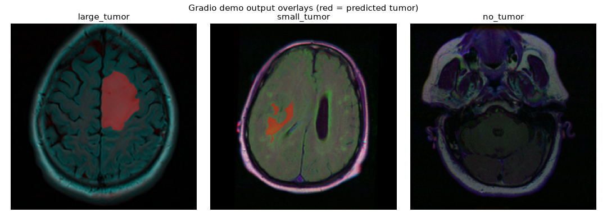

> **Research demo, not for clinical use.** This model has not been validated for diagnosis or treatment
> decisions and must not be used on real patients.

A U-Net that outlines lower-grade glioma (LGG) on single brain MRI slices, trained and evaluated with a
patient-level split, plus an error analysis and a Gradio demo.

**Headline result (17 held-out test patients, tumor-containing slices only):
Dice 0.778 ± 0.271, IoU 0.695 ± 0.267 (median patient Dice 0.890).**


*Green = ground truth, red dashed = prediction. Rows: best, median and worst test patient by Dice.*

## Problem

Given one axial MRI slice, predict a pixel mask of the tumor. Manual outlining of gliomas is slow and
varies between readers; an automatic first draft is a common research target. Tumor is a small target:
about 65% of slices contain no tumor, and on slices that do, the tumor usually covers only a few
percent of the image.

## Data

[LGG MRI Segmentation](https://www.kaggle.com/datasets/mateuszbuda/lgg-mri-segmentation) (Buda et al., 2019),
from The Cancer Imaging Archive / TCGA.

| | |
|---|---|
| Patients | 110 |
| Slices | 3,929 (20–88 per patient) |
| Image | 256×256, 3 channels = pre-contrast, FLAIR, post-contrast |
| Mask | 256×256 binary, FLAIR abnormality outlined by a radiologist |
| Slices with tumor | 1,373 (34.9%) |

**Split by patient**, 70/15/15 (seed 42) → 77 / 16 / 17 patients (2,719 / 621 / 589 slices), stored in
[`splits.json`](splits.json). Slices from one patient are near-duplicates, so a slice-level split would leak
the same patient into training and test and inflate the scores.



## Method

- **Model:** U-Net with a ResNet-34 encoder pretrained on ImageNet
  ([segmentation_models_pytorch](https://github.com/qubvel-org/segmentation_models.pytorch)), 24.4M parameters, one output channel.
- **Loss:** binary cross-entropy + soft Dice (Dice counters the heavy background/tumor imbalance).
- **Input:** RGB slice normalized with ImageNet mean/std.
- **Augmentation (train only):** horizontal/vertical flips, rotation ±15°, brightness ±15%, applied jointly to
  image and mask ([preview](outputs/aug_preview.png)).
- **Training:** AdamW (lr 1e-3, weight decay 1e-4), cosine schedule, batch 16, 40 epochs, fp16 mixed precision
  on a Kaggle GPU (~22 s/epoch). Checkpoint kept from the epoch with the best validation Dice (epoch 27).
- **Sanity check before training:** the model fits 16 tumor slices to Dice 0.927 in 50 steps
  ([figure](outputs/overfit.png)).



## Results

Dice and IoU are computed **per patient**, pooling pixels over that patient's slices, then averaged over the
17 test patients (mean ± std). Prediction threshold 0.5.

| Test set (17 patients) | Dice | IoU |
|---|---|---|
| **Tumor-containing slices only (headline)** | **0.778 ± 0.271** | **0.695 ± 0.267** |
| All slices (also penalizes false alarms on tumor-free slices) | 0.770 ± 0.273 | 0.684 ± 0.266 |
| Tumor-only, median patient | 0.890 | 0.802 |
| Tumor-only, excluding the 2 failure patients (n=15) | 0.871 ± 0.096 | 0.783 ± 0.128 |
| Validation (16 patients), all slices | 0.855 ± 0.106 | 0.759 ± 0.141 |

- 30 of 359 tumor-free test slices receive some false-positive prediction (21 of them from one patient).
- 31 of 230 tumor slices receive no prediction at all.
- The large standard deviation comes from two patients (Dice 0.12 and 0.04); see below.

Full per-patient table: [RESULTS.md](RESULTS.md) and [`outputs/test_per_patient.csv`](outputs/test_per_patient.csv).

## Error analysis

**Small tumors are the main weakness.** Slice Dice rises steadily with tumor size (Spearman ρ = 0.65):

| Tumor area on slice | < 250 px | 250–500 | 500–1k | 1k–2k | > 2k |
|---|---|---|---|---|---|
| Slices | 24 | 28 | 35 | 72 | 71 |
| Mean slice Dice | 0.04 | 0.48 | 0.53 | 0.76 | 0.89 |



**Three failure modes** ([figure](outputs/failure_cases.png)):

1. **Over-segmentation of a whole hemisphere** (patient FG_A60K, Dice 0.12). The model predicts about 9.6× the
   true tumor area, outlining a broad, mildly bright region instead of the small midline lesion. This scan is
   grayscale (one sequence copied into all three channels), but grayscale alone does not explain it:
   4 training patients are also grayscale, and the grayscale validation patient scores 0.90.
2. **Whole tumor missed** (patient HT_A5RC, Dice 0.04). 14 of 15 tumor slices get no prediction, although
   the lesions are large. The FLAIR channel of this scan is unusually dark (4th lowest of 110 patients), but a
   validation patient with an equally dark FLAIR channel scores 0.85, so **the cause is unresolved**.
3. **Small tumors missed**, especially on the first/last slice of a tumor. 10 of 24 slices with < 250 px of
   tumor are missed entirely; 14 of the 31 completely missed slices are tumor-edge slices, although those
   are only 15% of tumor slices.



## v1 vs v2 (per-image normalization)

v2 changes one thing from v1: each image channel is standardized by its own mean and standard deviation over
the head region (`--norm per-image`), instead of ImageNet statistics. Everything else is identical (same
`splits.json`, seed 42, 40 epochs, ResNet-34 U-Net, Dice+BCE loss, same augmentation).

**v1 remains the headline model, because it won on validation**, which is the only set used to choose a model
(val per-patient Dice, all slices: v1 0.855 vs v2 0.844).

Read the test comparison with these caveats:

- **It is one training run per model, on 17 test patients**, and **one patient (HT_A5RC) drives most of the gain**:
  its Dice goes from 0.036 to 0.676, which alone moves the 17-patient mean by about 0.038. Per patient, v2 is better
  on 5, worse on 2 and within ±0.01 on 10 (median difference +0.004).
- **FG_A60K got worse, from 0.121 to 0.000.** The failure changed type: v1 over-segmented this patient, while v2
  predicts no tumor on 23 of its 24 tumor slices.
- **The comparison is not independent.** Per-image normalization was chosen *after* seeing the test-set failures
  in the error analysis, so the test set has influenced the design of v2.
- **The dark-FLAIR explanation for HT_A5RC is supported by this result, but not proven.** HT_A5RC has an unusually
  dark FLAIR channel, and per-image normalization largely fixes it; but a validation patient with a similarly dark
  FLAIR channel was already segmented well by v1, and this is a single run.

Both versions of the test comparison are shown below: all 17 patients, and without the two failure patients
(HT_A5RC and FG_A60K).

**All 17 test patients** (from [`outputs/v2/v1_vs_v2.md`](outputs/v2/v1_vs_v2.md)):

| Metric | v1 | v2 |
|---|---|---|
| Test Dice, tumor-only (mean ± std) | 0.778 ± 0.271 | 0.814 ± 0.226 |
| Test IoU, tumor-only (mean ± std) | 0.695 ± 0.267 | 0.729 ± 0.225 |
| Test Dice, tumor-only (median) | 0.890 | 0.902 |
| Test IoU, tumor-only (median) | 0.802 | 0.821 |
| Test Dice, all slices (mean ± std) | 0.770 ± 0.273 | 0.805 ± 0.224 |
| Test IoU, all slices (mean ± std) | 0.684 ± 0.266 | 0.714 ± 0.224 |
| Test Dice HT_A5RC (tumor-only) | 0.036 | 0.676 |
| Test Dice FG_A60K (tumor-only) | 0.121 | 0.000 |
| Test false-positive empty slices | 30/359 | 13/359 |
| Test tumor slices with no prediction | 31/230 | 37/230 |
| Test slice Dice, tumor <250 px (n=24) | 0.042 (missed 10) | 0.219 (missed 16) |
| Test slice Dice, tumor 250-500 px (n=28) | 0.482 (missed 4) | 0.536 (missed 9) |
| Test slice Dice, tumor 500-1k px (n=35) | 0.530 (missed 7) | 0.527 (missed 11) |
| Test slice Dice, tumor 1k-2k px (n=72) | 0.763 (missed 9) | 0.858 (missed 1) |
| Test slice Dice, tumor >2k px (n=71) | 0.888 (missed 1) | 0.899 (missed 0) |
| Val Dice, tumor-only (mean ± std) | 0.873 ± 0.077 | 0.864 ± 0.087 |
| Val IoU, tumor-only (mean ± std) | 0.782 ± 0.111 | 0.770 ± 0.120 |
| Val Dice, tumor-only (median) | 0.893 | 0.893 |
| Val Dice, all slices (mean ± std) [selection metric] | 0.855 ± 0.106 | 0.844 ± 0.120 |

**Without HT_A5RC and FG_A60K** (15 test patients): mean tumor-only Dice v1 0.871 vs v2 0.878. Tumor slices by size:

| Tumor area | n | v1 Dice (missed) | v2 Dice (missed) |
|---|---|---|---|
| < 250 px | 12 | 0.077 (8) | 0.367 (5) |
| 250–500 px | 22 | 0.592 (4) | 0.683 (3) |
| 500–1k px | 23 | 0.722 (3) | 0.750 (2) |
| 1k–2k px | 64 | 0.853 (2) | 0.876 (0) |
| > 2k px | 70 | 0.901 (0) | 0.906 (0) |

Without the two outliers v2 is ahead in every size bucket, most for the smallest tumors, but the < 250 px bucket
has only 12 slices. v2's training curves: [`outputs/v2/train_curves.png`](outputs/v2/train_curves.png).

## Demo

```bash
python src/app.py            # then open http://127.0.0.1:7860   (--share for a public link)
```

Upload a slice (.tif/.png/.jpg) → predicted tumor in red, plus tumor area in pixels and as % of the head area
(area is not given in mm² because the images do not store pixel spacing). Three example slices are in
[`examples/`](examples/). The demo uses the same preprocessing as evaluation and reproduces its pixel counts exactly.



## How to run

```bash
python -m venv .venv && source .venv/bin/activate
pip install -r requirements.txt

# Data: download from Kaggle into data/ (needs ~/.kaggle/kaggle.json)
kaggle datasets download -d mateuszbuda/lgg-mri-segmentation -p data --unzip
#   -> data/kaggle_3m/TCGA_*/ ...   (point --data-dir at the folder holding the TCGA_* folders)

python src/inspect_data.py                 # 1. counts, empty-mask %, outputs/samples.png
python src/make_splits.py                  # 2. patient-level split -> splits.json (already committed)
python src/check_dataset.py                # 3. batch shapes, outputs/aug_preview.png
python src/overfit_test.py                 # 4. overfit 16 tumor slices, Dice > 0.9
python src/train.py --data-dir data/kaggle_3m --max-samples 50 --epochs 3   # 5a. smoke test
python src/train.py --data-dir data/kaggle_3m --epochs 40                   # 5b. full run (GPU recommended)
python src/evaluate.py                     # 6. test Dice/IoU per patient -> outputs/test_per_*.csv
python src/error_analysis.py               # 7. figures + failure-mode stats
python src/app.py                          # 8. Gradio demo
```

Every script takes `--data-dir` (default `data/kaggle_3m`). On Kaggle, attach the dataset and run e.g.
`python src/train.py --data-dir /kaggle/input/lgg-mri-segmentation/kaggle_3m` (the exact path depends on the
dataset version).

**Pretrained checkpoints** (not stored in git; download from the GitHub releases, ~98 MB each):

```bash
# v1, the headline model (used by evaluate.py, error_analysis.py and app.py by default)
mkdir -p checkpoints
curl -L -o checkpoints/best.pt https://github.com/ritpupp/tumor-seg/releases/download/v1-baseline/best.pt

# v2, per-image normalization ABLATION (not the headline model); use with --ckpt checkpoints_v2/best.pt
mkdir -p checkpoints_v2
curl -L -o checkpoints_v2/best.pt https://github.com/ritpupp/tumor-seg/releases/download/v2-norm/best.pt
```

SHA-256: v1 `938ce9c1135a50959beb5788384c44d5565edf8c5b6fc80049a6ab73f16c2738`,
v2 `015c4c4769d76e3c61ef4c5403c59b35bbb2733ce40f3a9f24e4042b06488c77`
(release pages: [v1-baseline](https://github.com/ritpupp/tumor-seg/releases/tag/v1-baseline),
[v2-norm](https://github.com/ritpupp/tumor-seg/releases/tag/v2-norm)).
`train.py` refuses to overwrite an existing `best.pt`, so to train your own model pass a new `--ckpt-dir`.

**Repository layout**

```
src/            inspect_data, make_splits, dataset, check_dataset, model, overfit_test,
                train, evaluate, error_analysis, app
splits.json     patient-level train/val/test split
outputs/        figures and per-patient / per-slice result CSVs
examples/       3 test slices for the demo
RESULTS.md      all metrics;  LEARNING.md  step-by-step notes
```

## Limitations

- **Not a clinical tool.** Research demo only; no regulatory review and no clinical validation.
- **Small test set.** 17 test patients from one public dataset; the ± numbers are wide, and two patients
  move the mean by about 0.09 Dice. Results may not transfer to other scanners, protocols or hospitals.
- **2D, slice by slice.** The model sees no neighboring slices, which likely contributes to misses at the top
  and bottom of a tumor.
- **Small tumors are unreliable** (mean Dice 0.04 below 250 px), and one test tumor was missed entirely for
  reasons we could not pin down.
- **Single run, single seed, fixed threshold 0.5.** No hyperparameter search, cross-validation, or test-time
  augmentation; numbers may vary between training runs.
- **Labels** are one annotation per slice of FLAIR abnormality; inter-reader variability is not measured.
- **Tumor area is in pixels**, not mm², because pixel spacing is not available in this dataset's images.

## Reference

Buda M., Saha A., Mazurowski M. A. *Association of genomic subtypes of lower-grade gliomas with shape features
automatically extracted by a deep learning algorithm.* Computers in Biology and Medicine, 2019.
